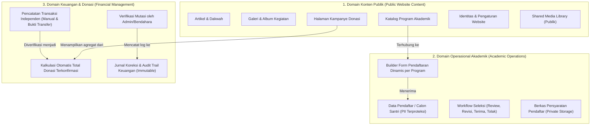
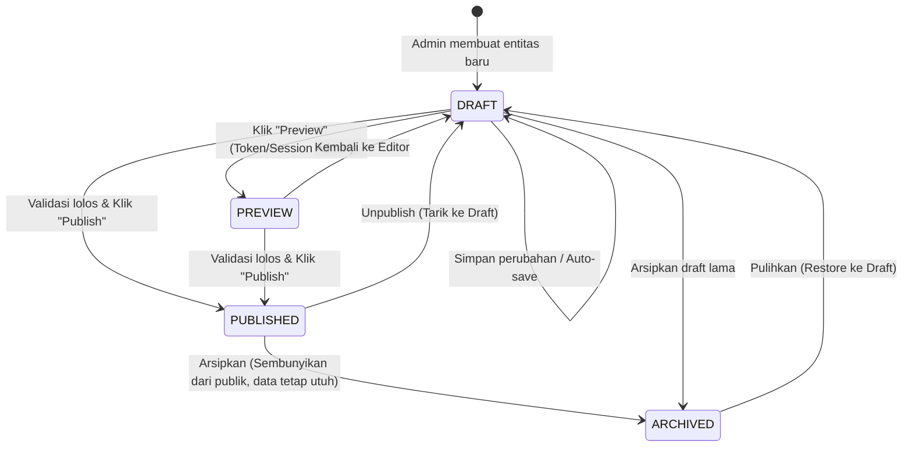
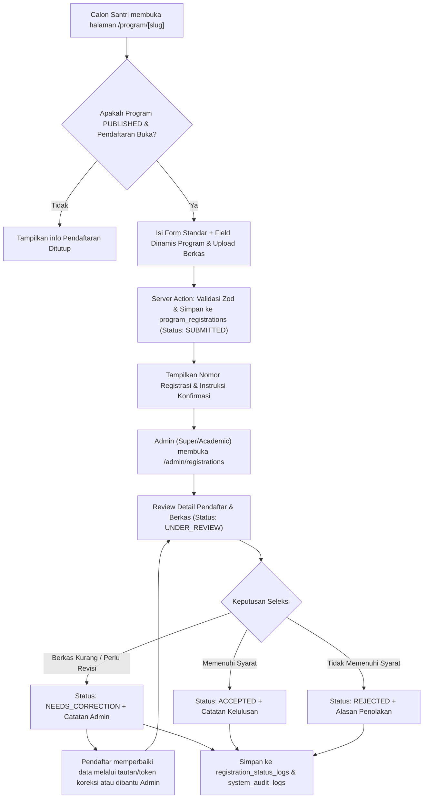
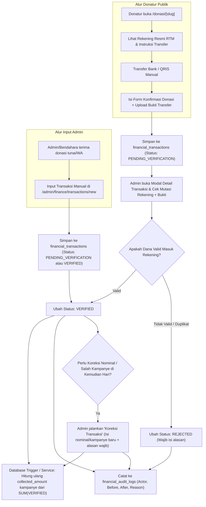
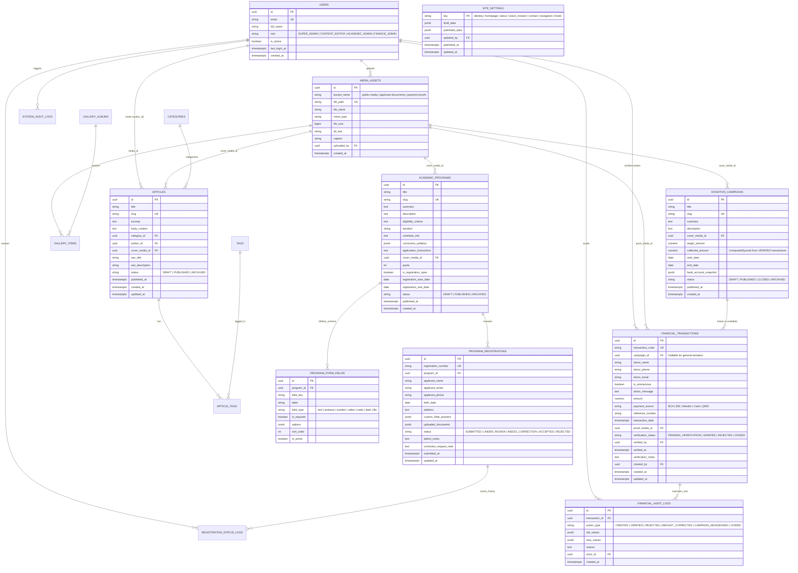

# Product Requirements Document (PRD): Rumah Tahfidz Muslimah (RTM) Content Management System

**Dokumen Versi:** 1.0.0  
**Status:** Menunggu Review (Pre-Implementation)  
**Target Stack:** Next.js (App Router), TypeScript, React, Tailwind CSS, PostgreSQL (Supabase Auth, Database, Storage)

---

## Pra-Analisis: Pemisahan Domain & Penyelesaian Ambiguitas

Sebelum masuk ke 12 deliverable utama, bagian ini merangkum hasil analisis kebutuhan, pemisahan domain sistem, serta keputusan bisnis yang telah diklarifikasi agar tidak ada aturan bisnis yang dikarang tanpa dasar.

### A. Pemisahan 3 Domain Utama (Separation of Concerns)

Sistem CMS Rumah Tahfidz Muslimah (RTM) dipisahkan secara tegas menjadi 3 domain arsitektur agar pengelolaan konten publik tidak bercampur dengan operasional akademik maupun pembukuan keuangan:



### B. Keputusan Bisnis yang Telah Diklarifikasi & Resolusi Ambiguitas

| No | Area Ambiguitas pada Draft Awal | Keputusan Bisnis & Aturan Sistem (Resolved) |
| :--- | :--- | :--- |
| 1 | **Struktur Role Admin (RBAC)** | Fokus utama operasional saat ini menggunakan **Super Admin** (akses penuh), namun arsitektur database dan middleware disiapkan mendukung **4 Role Granular** (`SUPER_ADMIN`, `CONTENT_EDITOR`, `ACADEMIC_ADMIN`, `FINANCE_ADMIN`) untuk memenuhi syarat pembatasan akses data pribadi santri (Req #6) dan otorisasi keuangan (Req #7). |
| 2 | **Alur Pembayaran & Verifikasi Donasi** | Menggunakan **Transfer Manual + Upload Bukti Transfer / Konfirmasi Admin** pada fase MVP, dengan skema tabel `financial_transactions` yang memiliki kolom `payment_gateway_provider` dan `external_reference_id` agar siap diintegrasikan dengan Payment Gateway (Midtrans/Xendit) tanpa migrasi destruktif. |
| 3 | **Struktur Formulir Pendaftaran Program** | Setiap program akademik memiliki **Data Diri Standar (Core Fields)** ditambah **Skema Field Dinamis (`form_schema` JSONB)** yang dapat dikustomisasi per program (misal: target hafalan, rekaman bacaan, pilihan jadwal mukim/non-mukim). |
| 4 | **Hubungan Kampanye vs Catatan Keuangan** | Catatan transaksi keuangan (`financial_transactions`) dikelola sebagai entitas buku besar (ledger) independen. Transaksi **boleh** terhubung ke kampanye tertentu (`campaign_id` terisi) atau berupa donasi umum/infaq operasional (`campaign_id = NULL`). Nilai `collected_amount` pada kampanye **tidak boleh diedit manual**, melainkan dihitung otomatis dari `SUM(amount)` transaksi berstatus `VERIFIED`. |
| 5 | **Metrik Dashboard (Zero Fabricated Metrics)** | Dashboard **hanya** menampilkan angka agregasi nyata dari tabel database (jumlah artikel terbit, pendaftar per status, kampanye aktif, total nominal transaksi `VERIFIED`). Tidak ada grafik pageviews/visitor palsu kecuali nantinya diintegrasikan dengan analitik riil. |
| 6 | **Koreksi Transaksi Keuangan** | Transaksi yang sudah `VERIFIED` **tidak boleh dihapus (`DELETE`)**. Jika terjadi kesalahan input nominal atau salah pilih kampanye, admin melakukan aksi **Koreksi/Void** yang wajib mengisi alasan koreksi dan otomatis tercatat di `financial_audit_logs`. |

---

## Deliverable 1: Refined PRD (Product Overview & Goals)

### 1.1 Visi Produk
Membangun Content Management System (CMS) kustom berbasis JavaScript/TypeScript untuk **Rumah Tahfidz Muslimah (RTM)** yang menggabungkan kemudahan pengelolaan konten ala WordPress dengan ketertiban administrasi akademik (penerimaan santri) dan transparansi pencatatan donasi/keuangan dalam satu dashboard terpusat.

### 1.2 Sasaran Utama (Objectives)
1. **Kemandirian Pengelolaan Konten:** Pengurus RTM dapat memperbarui profil lembaga, artikel dakwah, galeri kegiatan, dan informasi program tanpa mengubah kode sumber.
2. **Standarisasi Seleksi Santri:** Mengelola pendaftaran santri secara terstruktur dengan formulir yang fleksibel per program, pelacakan status seleksi, dan perlindungan data pribadi (PII).
3. **Akuntabilitas Donasi & Keuangan:** Memisahkan konten kampanye donasi dari pencatatan transaksi keuangan, memastikan setiap rupiah yang tampil di halaman publik berasal dari transaksi yang telah diverifikasi dan memiliki jejak audit.

### 1.3 Target Pengguna
- **Pengunjung Publik / Calon Donatur:** Membaca informasi program, artikel, galeri, serta menyalurkan donasi dan mengunggah bukti transfer.
- **Calon Santri / Wali Santri:** Membaca detail program akademik, mengisi formulir pendaftaran program, dan memantau/melengkapi perbaikan berkas jika diminta.
- **Administrator RTM (`SUPER_ADMIN` & Staf Terotorisasi):** Mengelola seluruh konten website, memproses pendaftaran santri, memverifikasi transaksi donasi, dan mengatur konfigurasi situs.

---

## Deliverable 2: User Roles and Permissions Matrix (RBAC)

Walaupun pada operasional awal seluruh fungsi dapat dijalankan oleh **Super Admin**, sistem menerapkan Role-Based Access Control (RBAC) di level Server Action dan Row-Level Security (RLS) sebagai berikut:

| Modul / Aksi | `SUPER_ADMIN` | `CONTENT_EDITOR` (Humas) | `ACADEMIC_ADMIN` (Kesantrian) | `FINANCE_ADMIN` (Bendahara) | Publik (Anonim) |
| :--- | :---: | :---: | :---: | :---: | :---: |
| **1. Auth & Users** | | | | | |
| Login / Logout / Edit Profil Sendiri | ✅ | ✅ | ✅ | ✅ | ❌ (Hanya Login) |
| Buat, Edit, Aktifkan/Nonaktifkan User & Role | ✅ | ❌ | ❌ | ❌ | ❌ |
| **2. Overview Dashboard** | | | | | |
| Lihat Ringkasan Konten & Program | ✅ | ✅ | ✅ | ✅ | ❌ |
| Lihat Ringkasan Nominal Keuangan Detail | ✅ | ❌ | ❌ | ✅ | ❌ |
| **3. Artikel & Galeri & Media** | | | | | |
| Buat, Edit, Preview, Arsipkan Artikel & Galeri | ✅ | ✅ | ❌ | ❌ | ❌ |
| Publish / Unpublish Artikel & Galeri | ✅ | ✅ | ❌ | ❌ | ❌ |
| Baca Artikel & Galeri `PUBLISHED` | ✅ | ✅ | ✅ | ✅ | ✅ |
| Upload & Kelola Shared Media Library Publik | ✅ | ✅ | ✅ (Program) | ✅ (Kampanye) | ❌ |
| **4. Program Akademik** | | | | | |
| Buat, Edit, Atur Skema Form & Publish Program | ✅ | ✅ (Konten) | ✅ (Penuh) | ❌ | ❌ |
| Lihat Informasi Program `PUBLISHED` | ✅ | ✅ | ✅ | ✅ | ✅ |
| **5. Pendaftaran Program (Data Pribadi / PII)** | | | | | |
| Submit Formulir Pendaftaran Program | ✅ | ❌ | ❌ | ❌ | ✅ |
| Lihat Detail Pendaftar, Dokumen & Riwayat | ✅ | ❌ | ✅ | ❌ | ❌ |
| Ubah Status Seleksi (Terima/Tolak/Minta Koreksi) | ✅ | ❌ | ✅ | ❌ | ❌ |
| **6. Kampanye Donasi & Keuangan** | | | | | |
| Buat, Edit, Publish, Tutup, Arsipkan Kampanye | ✅ | ✅ (Konten) | ❌ | ✅ (Penuh) | ❌ |
| Submit Konfirmasi Donasi Publik + Bukti Transfer | ✅ | ❌ | ❌ | ❌ | ✅ |
| Input Transaksi Manual, Verifikasi & Koreksi | ✅ | ❌ | ❌ | ✅ | ❌ |
| Lihat Buku Besar Transaksi & Audit Keuangan | ✅ | ❌ | ❌ | ✅ | ❌ |
| **7. Pengaturan Website & Audit Log** | | | | | |
| Edit Identitas, Beranda, Navigasi, Footer | ✅ | ✅ (Draft/Preview) | ❌ | ❌ | ❌ |
| Publish Pengaturan Website & Lihat System Audit Log | ✅ | ❌ | ❌ | ❌ | ❌ |

---

## Deliverable 3: User Journey and Flow Diagrams

### 3.1 Alur Siklus Hidup Konten (Artikel, Program, Kampanye)


### 3.2 Alur Pendaftaran Program Akademik & Seleksi Santri


### 3.3 Alur Kampanye Donasi & Verifikasi Transaksi Keuangan


---

## Deliverable 4: Route Map

### 4.1 Rute Website Publik (Public Facing)
| Route Path | Deskripsi Halaman | Sumber Data Utama |
| :--- | :--- | :--- |
| `/` | Beranda (Hero, Ringkasan Visi Misi, Program Unggulan, Kampanye Aktif, Artikel Terbaru, Galeri Pilihan) | `site_settings`, `academic_programs`, `donation_campaigns`, `articles`, `gallery_items` |
| `/tentang-kami` | Profil RTM, Sejarah, Visi & Misi, Struktur/Pengajar | `site_settings` (`about`, `vision_mission`) |
| `/program` | Katalog seluruh program akademik yang berstatus `PUBLISHED` | `academic_programs` |
| `/program/[slug]` | Detail program akademik (kurikulum, jadwal, syarat, CTA daftar) | `academic_programs` |
| `/program/[slug]/daftar` | Formulir pendaftaran dinamis yang terhubung dengan program terkait | `academic_programs`, `program_form_fields` |
| `/program/cek-status` | Halaman cek status pendaftaran menggunakan Nomor Registrasi + No HP/Email | `program_registrations` |
| `/donasi` | Daftar kampanye donasi aktif (`PUBLISHED`) & info rekening donasi umum | `donation_campaigns` |
| `/donasi/[slug]` | Detail kampanye donasi, progres dana terkumpul (`VERIFIED`), daftar doa/donatur (opsional anonim) | `donation_campaigns`, `financial_transactions` (public summary) |
| `/donasi/[slug]/konfirmasi` | Formulir konfirmasi transfer donasi & upload bukti pembayaran | `donation_campaigns`, `financial_transactions` |
| `/artikel` | Daftar artikel dakwah & berita RTM (dengan pencarian, filter kategori & tag) | `articles`, `categories` |
| `/artikel/[slug]` | Halaman baca artikel lengkap + metadata SEO & artikel terkait | `articles` |
| `/galeri` | Galeri foto dokumentasi kegiatan RTM (filter per album/kegiatan) | `gallery_albums`, `gallery_items` |
| `/kontak` | Informasi alamat, peta, kontak WhatsApp, email, dan media sosial | `site_settings` (`contact`, `social_links`) |

### 4.2 Rute Dashboard Admin (Protected Administrative Routes)
Seluruh rute `/admin/*` (kecuali `/admin/login` dan `/admin/forgot-password`) dilindungi oleh Server Middleware & Session Verification.

| Route Path | Modul | Hak Akses Role | Deskripsi Fungsi |
| :--- | :--- | :--- | :--- |
| `/admin/login` | Auth | Publik (Unauthenticated) | Halaman login administrator |
| `/admin` | Overview | Semua Admin | Ringkasan statistik riil, aktivitas terbaru, filter tanggal, & quick actions |
| `/admin/profile` | Auth | Semua Admin | Pengaturan profil akun sendiri & ubah password |
| `/admin/articles` | Artikel | `SUPER_ADMIN`, `CONTENT_EDITOR` | Tabel daftar artikel (search, filter status/kategori, bulk archive) |
| `/admin/articles/new` | Artikel | `SUPER_ADMIN`, `CONTENT_EDITOR` | Editor pembuatan artikel baru (Rich Text, SEO, Cover Image) |
| `/admin/articles/[id]/edit` | Artikel | `SUPER_ADMIN`, `CONTENT_EDITOR` | Editor pembaruan artikel & tombol Preview |
| `/admin/articles/categories` | Artikel | `SUPER_ADMIN`, `CONTENT_EDITOR` | Manajemen kategori & tag artikel |
| `/admin/gallery` | Galeri | `SUPER_ADMIN`, `CONTENT_EDITOR` | Manajemen foto galeri & pengurutan (`sort_order`) |
| `/admin/gallery/albums` | Galeri | `SUPER_ADMIN`, `CONTENT_EDITOR` | Manajemen album / koleksi kegiatan galeri |
| `/admin/media` | Media | Semua Admin | Shared Media Library (upload, edit alt text/caption, hapus aman) |
| `/admin/programs` | Program | `SUPER_ADMIN`, `ACADEMIC_ADMIN`, `CONTENT_EDITOR` | Daftar program akademik & status buka/tutup pendaftaran |
| `/admin/programs/new` | Program | `SUPER_ADMIN`, `ACADEMIC_ADMIN` | Form pembuatan program akademik & konfigurasi form pendaftaran |
| `/admin/programs/[id]/edit` | Program | `SUPER_ADMIN`, `ACADEMIC_ADMIN`, `CONTENT_EDITOR` | Edit konten program & builder field formulir pendaftaran dinamis |
| `/admin/registrations` | Pendaftaran | `SUPER_ADMIN`, `ACADEMIC_ADMIN` | Daftar pendaftar santri (filter program, tanggal, status seleksi) |
| `/admin/registrations/[id]` | Pendaftaran | `SUPER_ADMIN`, `ACADEMIC_ADMIN` | Detail lengkap pendaftar, viewer berkas, log riwayat, & aksi seleksi |
| `/admin/campaigns` | Donasi | `SUPER_ADMIN`, `FINANCE_ADMIN`, `CONTENT_EDITOR` | Daftar kampanye donasi, progres riil, status publikasi |
| `/admin/campaigns/new` | Donasi | `SUPER_ADMIN`, `FINANCE_ADMIN` | Pembuatan kampanye donasi baru |
| `/admin/campaigns/[id]/edit` | Donasi | `SUPER_ADMIN`, `FINANCE_ADMIN`, `CONTENT_EDITOR` | Edit kampanye, tutup kampanye, lihat daftar transaksi terkait |
| `/admin/finance/transactions` | Keuangan | `SUPER_ADMIN`, `FINANCE_ADMIN` | Buku besar transaksi donasi, filter verifikasi, modal detail & input manual |
| `/admin/finance/audit-logs` | Keuangan | `SUPER_ADMIN`, `FINANCE_ADMIN` | Riwayat verifikasi & koreksi transaksi keuangan (immutable) |
| `/admin/settings` | Pengaturan | `SUPER_ADMIN`, `CONTENT_EDITOR` | Pengaturan identitas lembaga, beranda, tentang kami, visi-misi, kontak, navigasi, footer + Preview |
| `/admin/users` | Users | `SUPER_ADMIN` | Manajemen akun admin (buat user, ubah role, aktifkan/nonaktifkan) |
| `/admin/audit-logs` | Platform | `SUPER_ADMIN` | Log aktivitas administratif seluruh sistem |

---

## Deliverable 5: Functional Requirements with Unique IDs

### 5.1 Authentication & User Management (`FR-AUTH`)
- **`FR-AUTH-01`**: Sistem wajib menyediakan halaman login menggunakan email dan password melalui Supabase Auth dengan proteksi rate-limiting.
- **`FR-AUTH-02`**: Sistem wajib memblokir akses ke seluruh rute `/admin/*` dan Server Actions administratif bagi pengguna yang belum login atau memiliki status akun `is_active = false`.
- **`FR-AUTH-03`**: Pengguna yang sedang login dapat memperbarui nama lengkap, foto profil, dan kata sandi mereka sendiri.
- **`FR-AUTH-04`**: `SUPER_ADMIN` dapat membuat akun admin baru, menetapkan role (`SUPER_ADMIN`, `CONTENT_EDITOR`, `ACADEMIC_ADMIN`, `FINANCE_ADMIN`), mengedit profil user lain, serta mengaktifkan/menonaktifkan (`deactivate`) akun tanpa menghapus histori audit user tersebut.
- **`FR-AUTH-05`**: Ketika akun dinonaktifkan (`is_active = false`), sesi aktif user tersebut harus dicabut dan tidak dapat melakukan operasi apa pun di server.

### 5.2 Overview Dashboard (`FR-DASH`)
- **`FR-DASH-01`**: Dashboard wajib menampilkan metrik ringkasan berdasarkan query database aktual:
  1. Total Artikel (`PUBLISHED` vs `DRAFT`).
  2. Total Program Akademik Aktif & Total Pendaftar (`SUBMITTED` / `NEED_REVIEW`, `ACCEPTED`).
  3. Total Kampanye Donasi Aktif (`PUBLISHED` & belum melewati `end_date`).
  4. Total Donasi Terkonfirmasi (`SUM(amount)` dari transaksi `VERIFIED`) dan jumlah transaksi `PENDING_VERIFICATION`.
- **`FR-DASH-02`**: Dashboard menyediakan filter rentang tanggal (*Hari Ini, 7 Hari Terakhir, 30 Hari Terakhir, Bulan Ini, Kustom*) yang memfilter metrik pendaftaran, transaksi donasi, dan log aktivitas.
- **`FR-DASH-03`**: Dashboard menampilkan 10 aktivitas administratif terbaru dari `system_audit_logs`.
- **`FR-DASH-04`**: Dashboard menyediakan tombol *Quick Actions* (Tulis Artikel Baru, Tambah Transaksi Donasi, Lihat Pendaftar Baru, Buat Kampanye) sesuai izin role pengguna.

### 5.3 Article Management (`FR-ART`)
- **`FR-ART-01`**: Admin dapat membuat, mengedit, melihat pratinjau (*preview*), mempublikasikan (`PUBLISHED`), mengembalikan ke draf (`DRAFT`), dan mengarsipkan (`ARCHIVED`) artikel.
- **`FR-ART-02`**: Editor artikel wajib menyediakan Rich-Text Editor (mendukung heading H2-H4, bold, italic, list, blockquote, link, tabel, embed gambar dari Media Library, dan kutipan ayat Al-Qur'an/Arab dengan dukungan teks RTL).
- **`FR-ART-03`**: Setiap artikel memiliki atribut: `title`, `slug`, `excerpt`, `body_html`/`body_json`, `category_id`, `tags[]`, `author_id`, `cover_media_id`, `seo_title`, `seo_description`, `status`, dan `published_at`.
- **`FR-ART-04`**: Sistem wajib menggenerasi `slug` otomatis dari `title` dan memvalidasi keunikan `slug`. Jika terjadi duplikasi, sistem menolak penyimpanan atau menawarkan akhiran unik (misal `-2`).
- **`FR-ART-05`**: Daftar artikel di dashboard mendukung pencarian berdasarkan judul/isi, penyaringan berdasarkan `status`, `category`, `tag`, `author`, serta pengurutan dan paginasi.

### 5.4 Gallery & Shared Media Management (`FR-GAL` & `FR-MED`)
- **`FR-MED-01`**: Sistem menyediakan *Shared Media Library* terpusat untuk mengunggah gambar (JPG, PNG, WEBP, SVG) dan dokumen resmi dengan validasi ukuran (maks 5MB untuk gambar publik) dan tipe MIME di sisi server.
- **`FR-MED-02`**: Setiap item media menyimpan metadata: `file_name`, `file_path`, `mime_type`, `file_size`, `width`, `height`, `alt_text`, `caption`, dan `uploaded_by`.
- **`FR-MED-03`**: Gambar yang sudah digunakan pada artikel, program, galeri, atau kampanye dapat dipilih ulang melalui *Media Picker Modal* tanpa perlu mengunggah ulang.
- **`FR-GAL-01`**: Admin dapat mengelompokkan foto ke dalam Album Kegiatan (`gallery_albums`) atau menampilkannya sebagai item galeri mandiri (`gallery_items`).
- **`FR-GAL-02`**: Setiap item galeri memiliki judul, `alt_text`, `caption`, urutan tampil (`sort_order`), asosiasi album, dan status publikasi (`DRAFT`, `PUBLISHED`, `ARCHIVED`).

### 5.5 Academic Program Management (`FR-PRG`)
- **`FR-PRG-01`**: Admin dapat membuat, mengedit, mempublikasikan, dan mengarsipkan program akademik yang ditawarkan RTM (contoh: *Tahfidz Reguler Anak*, *Karantina Tahfidz Muslimah*, *Tahsin Dewasa*).
- **`FR-PRG-02`**: Setiap program memiliki atribut: `title`, `slug`, `summary`, `description`, `eligibility_criteria` (syarat peserta), `duration`, `schedule_info`, `curriculum_syllabus` (list materi/target), `cover_media_id`, `application_instructions`, `quota`, `is_registration_open` (boolean), `registration_start_date`, `registration_end_date`, dan `status` (`DRAFT`, `PUBLISHED`, `ARCHIVED`).
- **`FR-PRG-03`**: Setiap program terhubung ke konfigurasi formulir pendaftarannya sendiri (`program_form_fields`), di mana Admin dapat menambahkan field kustom (teks, angka, pilihan ganda/select, tanggal, atau upload berkas seperti rekaman bacaan/KTP/KK) di samping field biodata standar.

### 5.6 Program Registrations (`FR-REG`)
- **`FR-REG-01`**: Halaman publik `/program/[slug]/daftar` merender formulir pendaftaran berdasarkan konfigurasi program terkait dan hanya menerima kiriman jika program berstatus `PUBLISHED` dan `is_registration_open = true`.
- **`FR-REG-02`**: Saat pendaftar mengirim formulir, sistem menghasilkan kode unik `registration_number` (format: `RTM-REG-YYYYMMDD-XXXX`) dan menyimpan data ke `program_registrations` dengan status awal `SUBMITTED`.
- **`FR-REG-03`**: Di dashboard `/admin/registrations`, Admin yang berwenang (`SUPER_ADMIN`, `ACADEMIC_ADMIN`) dapat memfilter pendaftar berdasarkan program, rentang tanggal pendaftaran, dan status seleksi (`SUBMITTED`, `UNDER_REVIEW`, `NEEDS_CORRECTION`, `ACCEPTED`, `REJECTED`), serta mencari berdasarkan nama, nomor registrasi, atau nomor WhatsApp.
- **`FR-REG-04`**: Halaman detail pendaftar menampilkan biodata lengkap, jawaban field dinamis, pratinjau berkas persyaratan (melalui *Signed URL* berbatas waktu), serta riwayat perubahan status (`registration_status_logs`).
- **`FR-REG-05`**: Admin dapat mengubah status pendaftar menjadi `UNDER_REVIEW`, `NEEDS_CORRECTION` (wajib menyertakan catatan koreksi), `ACCEPTED`, atau `REJECTED` dan menambahkan catatan administratif internal.

### 5.7 Donation Campaigns and Finance (`FR-CMP` & `FR-FIN`)
- **`FR-CMP-01`**: Admin dapat membuat, mengedit, mempublikasikan (`PUBLISHED`), menutup (`CLOSED`), dan mengarsipkan (`ARCHIVED`) kampanye donasi.
- **`FR-CMP-02`**: Setiap kampanye memiliki atribut: `title`, `slug`, `summary`, `description`, `cover_media_id`, `target_amount`, `start_date`, `end_date`, `bank_account_info`, dan `status`.
- **`FR-FIN-01`**: Catatan transaksi keuangan (`financial_transactions`) dikelola secara terpisah dari konten kampanye. Admin dapat mencatat transaksi baru secara manual (misal donasi tunai/transfer langsung) maupun memproses konfirmasi donasi yang masuk dari form publik.
- **`FR-FIN-02`**: Setiap transaksi mencatat: `transaction_code` (`RTM-TRX-YYYYMMDD-XXXX`), `campaign_id` (opsional/nullable untuk donasi umum), `donor_name`, `donor_phone`, `donor_email`, `is_anonymous` (tampil sebagai "Hamba Allah" di publik), ` donor_message`, `amount`, `payment_method`/`payment_source` (nama bank/tunai/QRIS), `reference_number`, `transaction_date`, `proof_media_id` (bukti transfer), `verification_status` (`PENDING_VERIFICATION`, `VERIFIED`, `REJECTED`, `VOIDED`), `verified_by`, `verified_at`, dan `verification_notes`.
- **`FR-FIN-03`**: Dashboard menyediakan **Transaction Detail Modal** untuk memeriksa bukti transfer secara berdampingan dengan detail nominal, referensi mutasi, dan tombol aksi Verifikasi / Tolak, serta halaman detail penuh untuk histori audit transaksi tersebut.
- **`FR-FIN-04`**: Total donasi terkumpul pada kampanye (`collected_amount`) dan statistik keuangan di dashboard **wajib** dihitung secara dinamis/agregat murni dari transaksi dengan `verification_status = 'VERIFIED'`.
- **`FR-FIN-05`**: Setiap perubahan status verifikasi atau koreksi nominal/kampanye pada transaksi wajib menulis entri baru ke `financial_audit_logs` yang menyimpan nilai sebelum (`old_values`), nilai sesudah (`new_values`), pelaku (`actor_id`), waktu, dan alasan wajib (`reason`).

### 5.8 Website Display and Settings (`FR-SET`)
- **`FR-SET-01`**: Admin dapat mengelola pengaturan tampilan dan identitas website yang terbagi dalam bagian terstruktur:
  1. **Identitas Lembaga**: Nama lembaga, tagline, logo utama, favicon, deskripsi singkat SEO global.
  2. **Konten Beranda (Homepage)**: Judul & subjudul Hero, gambar Hero, tombol CTA utama, highlight statistik santri/hafalan (dengan label jelas), dan seksi pengumuman.
  3. **Tentang Kami & Visi Misi**: Sejarah singkat, profil Rumah Tahfidz Muslimah, teks Visi, daftar poin Misi, dan nilai-nilai lembaga.
  4. **Kontak & Lokasi**: Alamat lengkap, link Google Maps / embed koordinat, nomor WhatsApp admin, email resmi, jam operasional, dan daftar rekening resmi lembaga.
  5. **Media Sosial, Navigasi & Footer**: Tautan Instagram, YouTube, Facebook, TikTok; susunan label & tautan menu navigasi header; teks hak cipta & tautan cepat footer.
- **`FR-SET-02`**: Pengaturan website mendukung penyimpanan sebagai *Draft Konfigurasi* (`draft_data`) dan mode **Preview** sebelum dipublikasikan (`published_data`) ke website publik.
- **`FR-SET-03`**: Seluruh input pengaturan divalidasi dengan skema ketat (URL valid, teks terstruktur) dan tidak mengizinkan injeksi script, HTML mentah berbahaya, atau pengubahan struktur layout kode aplikasi.

### 5.9 Shared Platform Requirements (`FR-PLT`)
- **`FR-PLT-01`**: Seluruh aksi mutasi penting (Create, Update, Publish, Archive, Status Change, Role Change) wajib dicatat ke dalam `system_audit_logs`.
- **`FR-PLT-02`**: Seluruh halaman tabel di dashboard wajib memiliki *Loading Skeleton*, *Empty State* yang informatif beserta tombol aksi, notifikasi *Toast Success/Error*, serta *Error Boundary*.
- **`FR-PLT-03`**: Antarmuka dashboard wajib responsif untuk perangkat mobile (drawer sidebar, tabel dengan horizontal scroll / card view ringkas) dan desktop.
- **`FR-PLT-04`**: Sistem menerapkan kebijakan *Safe Deletion*: entitas utama (Artikel, Program, Pendaftaran, Kampanye, Transaksi, User) menggunakan mekanisme *Archive / Soft Delete* atau *Deactivate* agar integritas referensial dan histori laporan tetap terjaga.

---

## Deliverable 6: Business Rules and Acceptance Criteria

### 6.1 Aturan Bisnis Utama (Core Business Rules)
- **`BR-01 (No Fabricated Metrics)`**: Sistem dilarang menampilkan angka statistik buatan, grafik dummy, atau klaim donasi yang tidak bersumber dari baris data valid di database.
- **`BR-02 (Slug Immutability & Uniqueness)`**: Slug pada artikel, program, dan kampanye harus unik per tabel. Jika slug dari entitas yang sudah `PUBLISHED` diubah, sistem memberikan peringatan dampak SEO.
- **`BR-03 (Financial Independence & Integrity)`**: Menghapus atau mengarsipkan kampanye donasi **tidak pernah** menghapus transaksi keuangan yang terhubung dengannya. Kampanye yang sudah memiliki minimal 1 transaksi tidak boleh dihapus permanen (`HARD DELETE`), hanya boleh diubah statusnya menjadi `CLOSED` atau `ARCHIVED`.
- **`BR-04 (Verified-Only Calculation)`**: Transaksi dengan status `PENDING_VERIFICATION`, `REJECTED`, atau `VOIDED` tidak boleh ditambahkan ke progres bar kampanye publik maupun total penerimaan donasi di Overview Dashboard.
- **`BR-05 (Mandatory Audit Reason on Financial Change)`**: Setiap penolakan transaksi (`REJECTED`) atau koreksi transaksi yang sudah `VERIFIED` wajib menyertakan alasan minimal 10 karakter.
- **`BR-06 (Applicant PII Protection)`**: Data pendaftar santri (`program_registrations`) dan file dokumen persyaratan disimpan di bucket private (`applicant-documents`) yang hanya dapat diakses oleh `SUPER_ADMIN` dan `ACADEMIC_ADMIN` menggunakan *Signed URL* yang kedaluwarsa dalam $\le 15$ menit.
- **`BR-07 (Constrained Site Customization)`**: Pengaturan website hanya mengubah data konten terstruktur (teks, gambar, urutan menu yang diizinkan, visibilitas seksi) dan tidak dapat mengubah struktur komponen React atau CSS dasar website.

### 6.2 Kriteria Penerimaan (Acceptance Criteria - Given/When/Then)

| ID | Modul | Kriteria Penerimaan (Given / When / Then) |
| :--- | :--- | :--- |
| **`AC-AUTH-01`** | Auth & RBAC | **Given** user dengan role `CONTENT_EDITOR` sedang login,<br>**When** user mencoba mengakses `/admin/finance/transactions` atau memanggil Server Action `verifyTransaction()`,<br>**Then** server menolak permintaan dengan status `403 Forbidden` dan mencatat percobaan akses. |
| **`AC-DASH-01`** | Overview | **Given** terdapat 3 transaksi `VERIFIED` senilai total Rp 1.500.000 dan 2 transaksi `PENDING_VERIFICATION` senilai Rp 500.000,<br>**When** Admin membuka `/admin`,<br>**Then** kartu "Total Donasi Terkonfirmasi" menampilkan tepat `Rp 1.500.000` dan badge "Menunggu Verifikasi" menampilkan `2 transaksi (Rp 500.000)`. |
| **`AC-ART-01`** | Artikel | **Given** sudah ada artikel dengan slug `keutamaan-menghafal-quran`,<br>**When** Admin membuat artikel baru dengan judul yang menghasilkan slug yang sama,<br>**Then** sistem menampilkan pesan validasi atau otomatis memberikan saran `keutamaan-menghafal-quran-2` sebelum disimpan. |
| **`AC-ART-02`** | Artikel | **Given** artikel berstatus `DRAFT`,<br>**When** pengunjung publik mengakses `/artikel/[slug]`,<br>**Then** server mengembalikan halaman `404 Not Found`, namun ketika Admin yang login membuka `/artikel/[slug]?preview=true`, halaman tampil dengan banner "Mode Pratinjau Draft". |
| **`AC-PRG-01`** | Program & Form | **Given** Admin menambahkan field kustom "Target Juz Hafalan" (tipe: Select, wajib diisi) pada Program Karantina,<br>**When** calon santri membuka `/program/karantina/daftar`,<br>**Then** field "Target Juz Hafalan" muncul pada formulir dan menolak pengiriman jika belum dipilih. |
| **`AC-REG-01`** | Pendaftaran | **Given** pendaftar berstatus `SUBMITTED`,<br>**When** Admin mengubah status menjadi `NEEDS_CORRECTION` dengan catatan "Mohon unggah ulang foto KTP yang jelas",<br>**Then** status berubah menjadi `NEEDS_CORRECTION`, dan entri baru tercatat di `registration_status_logs` beserta nama Admin dan waktu perubahan. |
| **`AC-FIN-01`** | Keuangan | **Given** kampanye "Wakaf Al-Qur'an" memiliki total terkumpul Rp 5.000.000,<br>**When** Admin memverifikasi (`VERIFIED`) satu transaksi baru senilai Rp 250.000 untuk kampanye tersebut,<br>**Then** total terkumpul kampanye otomatis menjadi Rp 5.250.000 dan log verifikasi tercatat di `financial_audit_logs`. |
| **`AC-FIN-02`** | Keuangan | **Given** transaksi `RTM-TRX-20261019-0012` sudah berstatus `VERIFIED` dengan nominal Rp 1.000.000 (salah ketik dari Rp 100.000),<br>**When** Admin melakukan aksi "Koreksi Transaksi" menjadi Rp 100.000 dengan alasan "Salah input kelebihan satu angka nol, sesuai bukti mutasi BCA",<br>**Then** nominal transaksi diperbarui menjadi Rp 100.000, total kampanye berkurang Rp 900.000, dan `financial_audit_logs` menyimpan `old_amount: 1000000` dan `new_amount: 100000`. |
| **`AC-SET-01`** | Pengaturan | **Given** Admin mengubah teks Hero Beranda dan menyimpannya sebagai Draft,<br>**When** pengunjung publik membuka `/`,<br>**Then** pengunjung masih melihat teks Hero lama hingga Admin menekan tombol "Publikasikan Pengaturan". |

---

## Deliverable 7: Entity Relationship Diagram (ERD) & Database Schema

### 7.1 Entity Relationship Diagram (ERD)


### 7.2 PostgreSQL / Supabase SQL Schema Definition

Berikut adalah skema DDL PostgreSQL inti beserta trigger integritas keuangan yang menjamin `collected_amount` pada kampanye selalu akurat dari transaksi `VERIFIED`:

```sql
-- 1. Enums
CREATE TYPE user_role AS ENUM ('SUPER_ADMIN', 'CONTENT_EDITOR', 'ACADEMIC_ADMIN', 'FINANCE_ADMIN');
CREATE TYPE content_status AS ENUM ('DRAFT', 'PUBLISHED', 'ARCHIVED');
CREATE TYPE campaign_status AS ENUM ('DRAFT', 'PUBLISHED', 'CLOSED', 'ARCHIVED');
CREATE TYPE registration_status AS ENUM ('SUBMITTED', 'UNDER_REVIEW', 'NEEDS_CORRECTION', 'ACCEPTED', 'REJECTED');
CREATE TYPE transaction_verification_status AS ENUM ('PENDING_VERIFICATION', 'VERIFIED', 'REJECTED', 'VOIDED');

-- 2. Users Profile Table (Linked to auth.users)
CREATE TABLE public.users (
  id UUID PRIMARY KEY REFERENCES auth.users(id) ON DELETE RESTRICT,
  email TEXT UNIQUE NOT NULL,
  full_name TEXT NOT NULL,
  avatar_url TEXT,
  role user_role NOT NULL DEFAULT 'CONTENT_EDITOR',
  is_active BOOLEAN NOT NULL DEFAULT TRUE,
  last_login_at TIMESTAMPTZ,
  created_at TIMESTAMPTZ NOT NULL DEFAULT NOW(),
  updated_at TIMESTAMPTZ NOT NULL DEFAULT NOW()
);

-- 3. Shared Media Library
CREATE TABLE public.media_assets (
  id UUID PRIMARY KEY DEFAULT gen_random_uuid(),
  bucket_name TEXT NOT NULL DEFAULT 'public-media',
  file_path TEXT UNIQUE NOT NULL,
  file_name TEXT NOT NULL,
  mime_type TEXT NOT NULL,
  file_size BIGINT NOT NULL CHECK (file_size > 0),
  width INT,
  height INT,
  alt_text TEXT NOT NULL DEFAULT '',
  caption TEXT DEFAULT '',
  uploaded_by UUID REFERENCES public.users(id) ON DELETE SET NULL,
  is_archived BOOLEAN NOT NULL DEFAULT FALSE,
  created_at TIMESTAMPTZ NOT NULL DEFAULT NOW()
);

-- 4. Categories, Tags & Articles
CREATE TABLE public.categories (
  id UUID PRIMARY KEY DEFAULT gen_random_uuid(),
  name TEXT NOT NULL,
  slug TEXT UNIQUE NOT NULL,
  description TEXT,
  created_at TIMESTAMPTZ NOT NULL DEFAULT NOW()
);

CREATE TABLE public.tags (
  id UUID PRIMARY KEY DEFAULT gen_random_uuid(),
  name TEXT NOT NULL,
  slug TEXT UNIQUE NOT NULL
);

CREATE TABLE public.articles (
  id UUID PRIMARY KEY DEFAULT gen_random_uuid(),
  title TEXT NOT NULL,
  slug TEXT UNIQUE NOT NULL,
  excerpt TEXT NOT NULL DEFAULT '',
  body_content TEXT NOT NULL DEFAULT '',
  category_id UUID REFERENCES public.categories(id) ON DELETE SET NULL,
  author_id UUID NOT NULL REFERENCES public.users(id) ON DELETE RESTRICT,
  cover_media_id UUID REFERENCES public.media_assets(id) ON DELETE SET NULL,
  seo_title TEXT,
  seo_description TEXT,
  status content_status NOT NULL DEFAULT 'DRAFT',
  published_at TIMESTAMPTZ,
  created_at TIMESTAMPTZ NOT NULL DEFAULT NOW(),
  updated_at TIMESTAMPTZ NOT NULL DEFAULT NOW()
);

CREATE TABLE public.article_tags (
  article_id UUID NOT NULL REFERENCES public.articles(id) ON DELETE CASCADE,
  tag_id UUID NOT NULL REFERENCES public.tags(id) ON DELETE CASCADE,
  PRIMARY KEY (article_id, tag_id)
);

-- 5. Gallery Albums & Items
CREATE TABLE public.gallery_albums (
  id UUID PRIMARY KEY DEFAULT gen_random_uuid(),
  title TEXT NOT NULL,
  slug TEXT UNIQUE NOT NULL,
  description TEXT,
  event_date DATE,
  cover_media_id UUID REFERENCES public.media_assets(id) ON DELETE SET NULL,
  status content_status NOT NULL DEFAULT 'DRAFT',
  created_at TIMESTAMPTZ NOT NULL DEFAULT NOW(),
  updated_at TIMESTAMPTZ NOT NULL DEFAULT NOW()
);

CREATE TABLE public.gallery_items (
  id UUID PRIMARY KEY DEFAULT gen_random_uuid(),
  album_id UUID REFERENCES public.gallery_albums(id) ON DELETE SET NULL,
  media_id UUID NOT NULL REFERENCES public.media_assets(id) ON DELETE RESTRICT,
  title TEXT NOT NULL,
  alt_text TEXT NOT NULL,
  caption TEXT,
  sort_order INT NOT NULL DEFAULT 0,
  status content_status NOT NULL DEFAULT 'DRAFT',
  published_at TIMESTAMPTZ,
  created_at TIMESTAMPTZ NOT NULL DEFAULT NOW()
);

-- 6. Academic Programs & Dynamic Form Fields
CREATE TABLE public.academic_programs (
  id UUID PRIMARY KEY DEFAULT gen_random_uuid(),
  title TEXT NOT NULL,
  slug TEXT UNIQUE NOT NULL,
  summary TEXT NOT NULL,
  description TEXT NOT NULL,
  eligibility_criteria TEXT NOT NULL DEFAULT '',
  duration TEXT NOT NULL DEFAULT '',
  schedule_info TEXT NOT NULL DEFAULT '',
  curriculum_syllabus JSONB NOT NULL DEFAULT '[]'::jsonb,
  application_instructions TEXT NOT NULL DEFAULT '',
  cover_media_id UUID REFERENCES public.media_assets(id) ON DELETE SET NULL,
  quota INT CHECK (quota IS NULL OR quota >= 0),
  is_registration_open BOOLEAN NOT NULL DEFAULT FALSE,
  registration_start_date DATE,
  registration_end_date DATE,
  status content_status NOT NULL DEFAULT 'DRAFT',
  published_at TIMESTAMPTZ,
  created_at TIMESTAMPTZ NOT NULL DEFAULT NOW(),
  updated_at TIMESTAMPTZ NOT NULL DEFAULT NOW()
);

CREATE TABLE public.program_form_fields (
  id UUID PRIMARY KEY DEFAULT gen_random_uuid(),
  program_id UUID NOT NULL REFERENCES public.academic_programs(id) ON DELETE CASCADE,
  field_key TEXT NOT NULL,
  label TEXT NOT NULL,
  field_type TEXT NOT NULL CHECK (field_type IN ('text', 'textarea', 'number', 'select', 'radio', 'date', 'file')),
  placeholder TEXT,
  help_text TEXT,
  is_required BOOLEAN NOT NULL DEFAULT FALSE,
  options JSONB NOT NULL DEFAULT '[]'::jsonb,
  sort_order INT NOT NULL DEFAULT 0,
  is_active BOOLEAN NOT NULL DEFAULT TRUE,
  UNIQUE (program_id, field_key)
);

-- 7. Program Registrations & Status History
CREATE TABLE public.program_registrations (
  id UUID PRIMARY KEY DEFAULT gen_random_uuid(),
  registration_number TEXT UNIQUE NOT NULL,
  program_id UUID NOT NULL REFERENCES public.academic_programs(id) ON DELETE RESTRICT,
  applicant_name TEXT NOT NULL,
  applicant_email TEXT,
  applicant_phone TEXT NOT NULL,
  birth_date DATE NOT NULL,
  address TEXT NOT NULL,
  previous_education TEXT,
  current_memorization_juz INT DEFAULT 0,
  custom_answers JSONB NOT NULL DEFAULT '{}'::jsonb,
  uploaded_documents JSONB NOT NULL DEFAULT '[]'::jsonb,
  status registration_status NOT NULL DEFAULT 'SUBMITTED',
  admin_notes TEXT,
  correction_request_note TEXT,
  reviewed_by UUID REFERENCES public.users(id) ON DELETE SET NULL,
  submitted_at TIMESTAMPTZ NOT NULL DEFAULT NOW(),
  updated_at TIMESTAMPTZ NOT NULL DEFAULT NOW()
);

CREATE TABLE public.registration_status_logs (
  id UUID PRIMARY KEY DEFAULT gen_random_uuid(),
  registration_id UUID NOT NULL REFERENCES public.program_registrations(id) ON DELETE CASCADE,
  previous_status registration_status,
  new_status registration_status NOT NULL,
  notes TEXT,
  changed_by UUID REFERENCES public.users(id) ON DELETE SET NULL,
  created_at TIMESTAMPTZ NOT NULL DEFAULT NOW()
);

-- 8. Donation Campaigns & Independent Financial Transactions
CREATE TABLE public.donation_campaigns (
  id UUID PRIMARY KEY DEFAULT gen_random_uuid(),
  title TEXT NOT NULL,
  slug TEXT UNIQUE NOT NULL,
  summary TEXT NOT NULL,
  description TEXT NOT NULL,
  cover_media_id UUID REFERENCES public.media_assets(id) ON DELETE SET NULL,
  target_amount NUMERIC(15, 2) NOT NULL CHECK (target_amount >= 0),
  collected_amount NUMERIC(15, 2) NOT NULL DEFAULT 0 CHECK (collected_amount >= 0),
  verified_donor_count INT NOT NULL DEFAULT 0,
  start_date DATE NOT NULL DEFAULT CURRENT_DATE,
  end_date DATE,
  bank_account_info JSONB NOT NULL DEFAULT '[]'::jsonb,
  status campaign_status NOT NULL DEFAULT 'DRAFT',
  published_at TIMESTAMPTZ,
  created_at TIMESTAMPTZ NOT NULL DEFAULT NOW(),
  updated_at TIMESTAMPTZ NOT NULL DEFAULT NOW()
);

CREATE TABLE public.financial_transactions (
  id UUID PRIMARY KEY DEFAULT gen_random_uuid(),
  transaction_code TEXT UNIQUE NOT NULL,
  campaign_id UUID REFERENCES public.donation_campaigns(id) ON DELETE RESTRICT,
  donor_name TEXT NOT NULL,
  donor_phone TEXT,
  donor_email TEXT,
  is_anonymous BOOLEAN NOT NULL DEFAULT FALSE,
  donor_message TEXT,
  amount NUMERIC(15, 2) NOT NULL CHECK (amount > 0),
  payment_source TEXT NOT NULL,
  reference_number TEXT,
  transaction_date TIMESTAMPTZ NOT NULL DEFAULT NOW(),
  proof_media_id UUID REFERENCES public.media_assets(id) ON DELETE SET NULL,
  payment_gateway_provider TEXT DEFAULT 'MANUAL',
  external_reference_id TEXT,
  verification_status transaction_verification_status NOT NULL DEFAULT 'PENDING_VERIFICATION',
  verified_by UUID REFERENCES public.users(id) ON DELETE SET NULL,
  verified_at TIMESTAMPTZ,
  verification_notes TEXT,
  created_by UUID REFERENCES public.users(id) ON DELETE SET NULL,
  created_at TIMESTAMPTZ NOT NULL DEFAULT NOW(),
  updated_at TIMESTAMPTZ NOT NULL DEFAULT NOW()
);

CREATE TABLE public.financial_audit_logs (
  id UUID PRIMARY KEY DEFAULT gen_random_uuid(),
  transaction_id UUID NOT NULL REFERENCES public.financial_transactions(id) ON DELETE RESTRICT,
  action_type TEXT NOT NULL,
  old_values JSONB,
  new_values JSONB NOT NULL,
  reason TEXT NOT NULL,
  actor_id UUID REFERENCES public.users(id) ON DELETE SET NULL,
  created_at TIMESTAMPTZ NOT NULL DEFAULT NOW()
);

-- Trigger Function to Recalculate Campaign Totals Automatically from VERIFIED Transactions
CREATE OR REPLACE FUNCTION public.recalculate_campaign_totals()
RETURNS TRIGGER AS $$
DECLARE
  target_campaign_id UUID;
BEGIN
  IF (TG_OP = 'UPDATE' AND OLD.campaign_id IS DISTINCT FROM NEW.campaign_id) THEN
    IF OLD.campaign_id IS NOT NULL THEN
      UPDATE public.donation_campaigns
      SET collected_amount = COALESCE((
            SELECT SUM(amount) FROM public.financial_transactions
            WHERE campaign_id = OLD.campaign_id AND verification_status = 'VERIFIED'
          ), 0),
          verified_donor_count = (
            SELECT COUNT(*) FROM public.financial_transactions
            WHERE campaign_id = OLD.campaign_id AND verification_status = 'VERIFIED'
          ),
          updated_at = NOW()
      WHERE id = OLD.campaign_id;
    END IF;
  END IF;

  target_campaign_id := COALESCE(NEW.campaign_id, OLD.campaign_id);
  IF target_campaign_id IS NOT NULL THEN
    UPDATE public.donation_campaigns
    SET collected_amount = COALESCE((
          SELECT SUM(amount) FROM public.financial_transactions
          WHERE campaign_id = target_campaign_id AND verification_status = 'VERIFIED'
        ), 0),
        verified_donor_count = (
          SELECT COUNT(*) FROM public.financial_transactions
          WHERE campaign_id = target_campaign_id AND verification_status = 'VERIFIED'
        ),
        updated_at = NOW()
    WHERE id = target_campaign_id;
  END IF;

  RETURN NEW;
END;
$$ LANGUAGE plpgsql SECURITY DEFINER;

CREATE TRIGGER trg_recalculate_campaign_totals
AFTER INSERT OR UPDATE OF amount, verification_status, campaign_id
ON public.financial_transactions
FOR EACH ROW EXECUTE FUNCTION public.recalculate_campaign_totals();

-- 9. Website Display & Settings
CREATE TABLE public.site_settings (
  key TEXT PRIMARY KEY,
  draft_data JSONB NOT NULL DEFAULT '{}'::jsonb,
  published_data JSONB NOT NULL DEFAULT '{}'::jsonb,
  updated_by UUID REFERENCES public.users(id) ON DELETE SET NULL,
  published_at TIMESTAMPTZ,
  updated_at TIMESTAMPTZ NOT NULL DEFAULT NOW()
);

-- 10. System Audit Logs
CREATE TABLE public.system_audit_logs (
  id UUID PRIMARY KEY DEFAULT gen_random_uuid(),
  actor_id UUID REFERENCES public.users(id) ON DELETE SET NULL,
  module TEXT NOT NULL,
  action TEXT NOT NULL,
  entity_type TEXT NOT NULL,
  entity_id TEXT NOT NULL,
  summary TEXT NOT NULL,
  metadata JSONB DEFAULT '{}'::jsonb,
  ip_address TEXT,
  created_at TIMESTAMPTZ NOT NULL DEFAULT NOW()
);
```

---

## Deliverable 8: API & Server-Action Contracts

Seluruh operasi tulis (mutasi) menggunakan **Next.js Server Actions** dengan pembungkus otorisasi terpusat `withAdminAuth(allowedRoles, actionFn)` dan validasi input **Zod**.

### 8.1 Format Standar Respons Server Action
```typescript
export type ActionResponse<T = void> =
  | { success: true; data: T; message?: string }
  | {
      success: false;
      error: {
        code: 'UNAUTHORIZED' | 'FORBIDDEN' | 'VALIDATION_ERROR' | 'CONFLICT_SLUG' | 'NOT_FOUND' | 'BUSINESS_RULE_VIOLATION' | 'INTERNAL_ERROR';
        message: string;
        fieldErrors?: Record<string, string[]>;
      };
    };
```

### 8.2 Daftar Kontrak Server Action & Route Handler Utama

| Modul | Nama Action / Endpoint | Allowed Roles | Input Payload (Zod Validated) | Efek Samping & Output |
| :--- | :--- | :--- | :--- | :--- |
| **Auth / Users** | `createAdminUser(input)` | `SUPER_ADMIN` | `{ email, fullName, role, temporaryPassword }` | Buat user di Supabase Auth + `public.users`, catat di `system_audit_logs`. |
| **Auth / Users** | `toggleUserActiveStatus(userId, isActive)` | `SUPER_ADMIN` | `{ userId: uuid, isActive: boolean }` | Cegah self-deactivation. Update `users.is_active`, cabut sesi aktif jika `false`. |
| **Overview** | `getDashboardOverview(dateRange)` | Semua Admin | `{ from?: Date, to?: Date }` | Query agregat riil untuk kartu ringkasan (tanpa metrik palsu). |
| **Articles** | `upsertArticle(input)` | `SUPER_ADMIN`, `CONTENT_EDITOR` | `{ id?, title, slug, excerpt, bodyContent, categoryId, tagIds[], coverMediaId, seoTitle, seoDescription, status }` | Cek keunikan `slug`. Jika `status === 'PUBLISHED'` dan belum punya `published_at`, set `NOW()`. Revalidate `/artikel`. |
| **Gallery & Media** | `uploadMediaAsset(formData)` | Semua Admin | `FormData (file, bucketName, altText, caption)` | Validasi MIME & ukuran file di server, unggah ke Supabase Storage, simpan ke `media_assets`. |
| **Programs** | `upsertAcademicProgram(input)` | `SUPER_ADMIN`, `ACADEMIC_ADMIN`, `CONTENT_EDITOR` | `{ id?, title, slug, summary, description, eligibility, duration, scheduleInfo, curriculum[], isRegistrationOpen, status, formFields[] }` | Simpan data program dan sinkronkan daftar field dinamis di `program_form_fields`. Revalidate `/program`. |
| **Registrations** | `submitProgramRegistration(input)` | Publik (Rate Limited) | `{ programId, applicantName, applicantPhone, applicantEmail?, birthDate, address, customAnswers, uploadedDocuments }` | Validasi bahwa program `PUBLISHED` & `is_registration_open = true`. Validasi `customAnswers` terhadap `program_form_fields`. Buat nomor registrasi unik. |
| **Registrations** | `updateRegistrationStatus(input)` | `SUPER_ADMIN`, `ACADEMIC_ADMIN` | `{ registrationId, newStatus, adminNotes?, correctionRequestNote? }` | Wajibkan `correctionRequestNote` jika `NEEDS_CORRECTION`. Update status & insert ke `registration_status_logs`. |
| **Campaigns** | `upsertDonationCampaign(input)` | `SUPER_ADMIN`, `FINANCE_ADMIN`, `CONTENT_EDITOR` | `{ id?, title, slug, summary, description, targetAmount, startDate, endDate?, bankAccountInfo[], status }` | Simpan kampanye (tanpa mengizinkan input `collected_amount`). Revalidate `/donasi`. |
| **Finance** | `submitPublicDonationConfirmation(input)` | Publik (Rate Limited) | `{ campaignId?, donorName, donorPhone, isAnonymous, donorMessage?, amount, paymentSource, referenceNumber?, transactionDate, proofFile }` | Unggah bukti ke bucket `payment-proofs`, buat baris `financial_transactions` dengan status `PENDING_VERIFICATION`. |
| **Finance** | `createManualTransaction(input)` | `SUPER_ADMIN`, `FINANCE_ADMIN` | `{ campaignId?, donorName, amount, paymentSource, referenceNumber, transactionDate, proofMediaId?, verifyImmediately: boolean, notes }` | Buat transaksi & catat ke `financial_audit_logs`. Trigger database otomatis mengupdate total kampanye jika `VERIFIED`. |
| **Finance** | `verifyOrRejectTransaction(input)` | `SUPER_ADMIN`, `FINANCE_ADMIN` | `{ transactionId, decision: 'VERIFIED' \| 'REJECTED', reason }` | Validasi `reason` wajib diisi jika `REJECTED`. Update status, catat `financial_audit_logs`, hitung ulang kampanye. |
| **Finance** | `correctVerifiedTransaction(input)` | `SUPER_ADMIN`, `FINANCE_ADMIN` | `{ transactionId, newAmount, newCampaignId?, newPaymentSource, reason }` | Wajib alasan $\ge 10$ karakter. Simpan `old_values` & `new_values` ke `financial_audit_logs`. Trigger hitung ulang kampanye lama & baru. |
| **Settings** | `saveSiteSettingsDraft(sectionKey, data)` | `SUPER_ADMIN`, `CONTENT_EDITOR` | `{ key, data: ValidatedSectionSchema }` | Simpan ke `site_settings.draft_data` untuk dapat dilihat di mode Preview. |
| **Settings** | `publishSiteSettings(sectionKey)` | `SUPER_ADMIN` | `{ key }` | Salin `draft_data` ke `published_data`, set `published_at = NOW()`, revalidate seluruh layout publik. |

---

## Deliverable 9: UI/UX Specification and Wireframes

### 9.1 Sistem Desain & Pedoman Visual (Design System)
- **Identitas Warna (Islami, Bersih, Terpercaya):**
  - **Primary (Emerald RTM):** `#065F46` (`emerald-800`) hingga `#047857` (`emerald-700`) — melambangkan keteduhan dan pertumbuhan.
  - **Secondary / Accent (Warm Gold):** `#B45309` (`amber-700`) / `#D97706` (`amber-600`) — untuk highlight donasi dan call-to-action penting.
  - **Neutral / Surface:** Background dashboard `#F8FAFC` (`slate-50`), Card `#FFFFFF`, Teks utama `#0F172A` (`slate-900`).
  - **Semantic Status Badges:**
    - `PUBLISHED` / `VERIFIED` / `ACCEPTED`: Hijau (`bg-emerald-100 text-emerald-800`)
    - `DRAFT` / `UNDER_REVIEW`: Abu-abu/Biru (`bg-slate-100 text-slate-700` / `bg-sky-100 text-sky-800`)
    - `PENDING_VERIFICATION` / `NEEDS_CORRECTION`: Kuning/Oranye (`bg-amber-100 text-amber-800`)
    - `REJECTED` / `VOIDED` / `ARCHIVED`: Merah/Rose (`bg-rose-100 text-rose-800`)
- **Tipografi:**
  - Heading & UI: `Plus Jakarta Sans` atau `Inter`
  - Kutipan Arab / Al-Qur'an: `Amiri` atau `Scheherazade New`

### 9.2 Wireframe 1: Admin Overview Dashboard (`/admin`)
```text
+--------------------------------------------------------------------------------------------------+
| [Logo RTM]  CMS Rumah Tahfidz Muslimah          [Lihat Website Publik ↗]  [🔔] [Super Admin ▾]   |
+----------------------+---------------------------------------------------------------------------+
| NAVIGASI UTAMA       | OVERVIEW DASHBOARD                        Filter: [ 30 Hari Terakhir ▾ ]  |
|                      |                                                                           |
| ● Overview           | +-----------------+ +-----------------+ +-----------------+ +-----------+ |
|                      | | Total Artikel   | | Pendaftar Santri| | Kampanye Aktif  | | Donasi    | |
| KONTEN WEBSITE       | | 24 Terbit       | | 48 Pendaftar    | | 4 Kampanye      | | Terverif. | |
| ○ Artikel & Dakwah   | | 5 Draft         | | 12 Perlu Review | | Target: 120 Jt  | | Rp 42,5Jt | |
| ○ Galeri & Album     | +-----------------+ +-----------------+ +-----------------+ +-----------+ |
| ○ Pustaka Media      |                                                                           |
| ○ Pengaturan Website | AKSI CEPAT (QUICK ACTIONS)                                                |
|                      | [+ Tulis Artikel] [+ Input Donasi Manual] [Cek 6 Bukti Transfer] [Program]|
| AKADEMIK & SANTRI    |                                                                           |
| ○ Program Akademik   | +-----------------------------------+ +---------------------------------+ |
| ○ Data Pendaftaran   | | PENDAFTAR TERBARU (Perlu Review)  | | TRANSAKSI MENUNGGU VERIFIKASI   | |
|                      | |-----------------------------------| |---------------------------------| |
| DONASI & KEUANGAN    | | Aisyah Putri - Tahfidz Reguler    | | TRX-1019-004 | Rp 500.000       | |
| ○ Kampanye Donasi    | | [SUBMITTED] 10 mnt lalu  [Review] | | Wakaf Quran  | [Cek Bukti]      | |
| ○ Transaksi Keuangan | | Fatimah Zahra - Karantina         | | TRX-1019-003 | Rp 1.000.000     | |
| ○ Audit Keuangan     | | [SUBMITTED] 2 jam lalu   [Review] | | Infaq Umum   | [Cek Bukti]      | |
|                      | +-----------------------------------+ +---------------------------------+ |
| SISTEM               |                                                                           |
| ○ Pengguna & Role    | AKTIVITAS ADMINISTRATIF TERBARU (AUDIT LOG)                               |
| ○ Log Audit Sistem   | • 13:05 - Super Admin memverifikasi transaksi RTM-TRX-20261019-002        |
|                      | • 11:20 - Humas mempublikasikan artikel "Jadwal Tahsin Semester Ganjil"   |
+----------------------+---------------------------------------------------------------------------+
```

### 9.3 Wireframe 2: Buku Besar Transaksi & Transaction Detail Modal (`/admin/finance/transactions`)
```text
+--------------------------------------------------------------------------------------------------+
| TRANSAKSI KEUANGAN & DONASI                                      [+ Catat Transaksi Manual]      |
|--------------------------------------------------------------------------------------------------|
| Cari: [ Kode TRX / Nama Donatur... ]  Kampanye: [ Semua ▾ ]  Status: [ Menunggu Verifikasi (6) ▾]|
|--------------------------------------------------------------------------------------------------|
| Kode TRX          | Tanggal    | Donatur        | Kampanye       | Nominal     | Status  | Aksi  |
|-------------------|------------|----------------|----------------|-------------|---------|-------|
| RTM-TRX-1019-004  | 19 Okt 26  | Hamba Allah    | Wakaf Al-Quran | Rp 500.000  | PENDING | [Cek] |
| RTM-TRX-1019-003  | 19 Okt 26  | Siti Rahmah    | Donasi Umum    | Rp 1.000.000| VERIFIED| [Cek] |
+--------------------------------------------------------------------------------------------------+

   ================ MODAL DETAIL & VERIFIKASI TRANSAKSI (Saat klik [Cek]) ================
   +-------------------------------------------------------------------------------------+
   | Detail Transaksi: RTM-TRX-20261019-004                              [Status: PENDING]|
   |-------------------------------------------------------------------------------------|
   | PRATINJAU BUKTI TRANSFER            | INFORMASI TRANSAKSI                           |
   | +---------------------------------+ | Nama Donatur   : Ukhti Nadia (Tampil: Anonim) |
   | |                                 | | Kontak WA      : 0812-xxxx-xxxx               |
   | |      [ Gambar Struk /           | | Kampanye       : Wakaf Al-Qur'an Santri       |
   | |        Bukti Mutasi BSI ]       | | Nominal Input  : Rp 500.000                   |
   | |                                 | | Metode / Bank  : Transfer BSI                 |
   | |   [🔍 Perbesar] [⬇ Unduh]       | | No. Referensi  : FT2629281992                 |
   | +---------------------------------+ | Waktu Transfer : 19 Okt 2026, 10:42 WIB       |
   |                                     | Pesan/Doa      : "Semoga berkah untuk santri" |
   |-------------------------------------+-----------------------------------------------|
   | CATATAN VERIFIKASI / ALASAN PENOLAKAN OR KOREKSI:                                   |
   | [ Dana sudah masuk di mutasi rekening BSI RTM tanggal 19/10 pukul 10:43           ] |
   |                                                                                     |
   | [Lihat Riwayat Audit Lengkap]          [Tolak Transaksi]  [✓ Verifikasi Dana Masuk] |
   +-------------------------------------------------------------------------------------+
```

### 9.4 Wireframe 3: Editor Program Akademik & Dynamic Form Builder (`/admin/programs/[id]/edit`)
```text
+--------------------------------------------------------------------------------------------------+
| ← Kembali ke Program    EDIT PROGRAM: Tahfidz Mukim 1 Tahun      [Preview] [Simpan Draft] [Terbit]|
+--------------------------------------------------------------------------------------------------+
| TAB:  (1) Informasi Publik Program   |  (2) Builder Formulir Pendaftaran   |  (3) Pendaftar (32) |
+--------------------------------------------------------------------------------------------------+
| [Tab 2 Aktif: KONFIGURASI FORMULIR PENDAFTARAN PROGRAM INI]                                      |
|                                                                                                  |
| Status Pendaftaran: [x] Buka Pendaftaran Publik   Kuota: [ 30 Santri ]   Batas: [ 30 Nov 2026 ]  |
|                                                                                                  |
| A. FIELD BIODATA STANDAR (Otomatis Aktif di Semua Program)                                       |
|    [🔒 Nama Lengkap]  [🔒 Nomor WhatsApp]  [🔒 Tanggal Lahir]  [🔒 Alamat Domisili]              |
|                                                                                                  |
| B. FIELD TAMBAHAN KHUSUS PROGRAM INI (Drag & Drop Urutan)              [+ Tambah Pertanyaan Baru]|
| +----------------------------------------------------------------------------------------------+ |
| | ☰ 1. Jumlah Hafalan Saat Ini (Juz)        | Tipe: Number  | [x] Wajib | [Edit] [Hapus]       | |
| | ☰ 2. Pilihan Asrama / Mukim               | Tipe: Select  | [x] Wajib | [Edit] [Hapus]       | |
| |      Opsi: ["Mukim Penuh", "Pulang Pergi"]                                                   | |
| | ☰ 3. Upload Rekaman Bacaan QS. Maryam 1-11| Tipe: File    | [x] Wajib | [Edit] [Hapus]       | |
| | ☰ 4. Upload Scan KTP / KK Wali            | Tipe: File    | [x] Wajib | [Edit] [Hapus]       | |
| +----------------------------------------------------------------------------------------------+ |
+--------------------------------------------------------------------------------------------------+
```

---

## Deliverable 10: Security Requirements and Test Plan

### 10.1 Keamanan Sistem (Security Requirements)
1. **Zero Client-Side Secret Exposure (`SEC-01`)**:
   - `SUPABASE_SERVICE_ROLE_KEY` dan kredensial database hanya boleh diakses di lingkungan server (`server-only` package di Next.js). Browser hanya menerima `NEXT_PUBLIC_SUPABASE_URL` dan `NEXT_PUBLIC_SUPABASE_ANON_KEY`.
2. **Double-Layer Authorization (`SEC-02`)**:
   - **Layer 1 (Application Server):** Setiap Server Action dan Route Handler wajib memanggil helper `requireRole(['SUPER_ADMIN', ...])` yang memverifikasi JWT session Supabase + mengecek kolom `role` dan `is_active = true` langsung di tabel `public.users`.
   - **Layer 2 (Database RLS):** Seluruh tabel PostgreSQL mengaktifkan Row-Level Security (RLS). Pengunjung publik (`anon`) hanya memiliki akses `SELECT` pada baris berstatus `PUBLISHED` di tabel `articles`, `gallery_items`, `academic_programs`, `donation_campaigns`, dan `site_settings.published_data`.
3. **Proteksi Data Pribadi Santri / PII (`SEC-03`)**:
   - Tabel `program_registrations` tidak memiliki policy `SELECT` publik.
   - Bucket storage `applicant-documents` dan `payment-proofs` diatur sebagai **Private Bucket**. File hanya bisa dilihat oleh Admin berwenang melalui *Signed URL* yang digenerasi di server dengan masa berlaku singkat (15 menit).
4. **Sanitasi Konten & Keamanan File Upload (`SEC-04`)**:
   - Output dari Rich-Text Editor untuk artikel dan deskripsi program wajib disanitasi di sisi server (misal menggunakan `sanitize-html` atau `DOMPurify` isomorfik) untuk mencegah Stored XSS.
   - Upload file memvalidasi *magic bytes* / MIME type (`image/jpeg`, `image/png`, `image/webp`, `application/pdf`, `audio/mpeg`) dan membatasi ukuran file.
5. **Rate Limiting Form Publik (`SEC-05`)**:
   - Endpoint publik pengiriman pendaftaran santri dan konfirmasi donasi dilindungi oleh rate-limiter berbasis IP dan/atau honeypot/Turnstile untuk mencegah spam.

### 10.2 Rencana Pengujian (Test Plan)

| Kategori Uji | Cakupan Pengujian | Skenario Utama yang Diuji |
| :--- | :--- | :--- |
| **Unit Testing (Vitest)** | Validator Zod, Helper Kalkulasi Keuangan, Slug Generator, Sanitasi HTML | - Pembuatan slug otomatis & penanganan karakter spesial/Arab.<br>- Validasi dinamis jawaban form pendaftaran santri terhadap konfigurasi `program_form_fields`.<br>- Penolakan koreksi transaksi jika `reason` kosong atau kurang dari 10 karakter. |
| **Integration & DB Testing** | Trigger PostgreSQL, RLS Policies, Server Actions | - Uji trigger `trg_recalculate_campaign_totals`: pastikan saat transaksi diubah dari `PENDING_VERIFICATION` -> `VERIFIED` -> `VOIDED`, kolom `collected_amount` pada kampanye terupdate secara presisi.<br>- Uji RLS: pastikan role `CONTENT_EDITOR` gagal membaca tabel `program_registrations` dan `financial_transactions`. |
| **End-to-End (Playwright)** | Alur Publik & Dashboard Admin | 1. **Alur Konten:** Login Admin -> Buat Artikel Draft -> Cek tidak muncul di publik -> Publish -> Cek tampil di `/artikel/[slug]`.<br>2. **Alur Akademik:** Admin buat Program + field kustom -> Santri daftar di publik -> Admin review & ubah status ke `ACCEPTED`.<br>3. **Alur Donasi:** Donatur submit konfirmasi transfer Rp 250.000 -> Progres kampanye belum berubah -> Admin verifikasi di Modal -> Progres kampanye bertambah Rp 250.000 & tercatat di Audit Log. |

---

## Deliverable 11: MVP Scope and Implementation Roadmap

### 11.1 Batasan Cakupan MVP (Practical MVP Scope)
Agar implementasi terarah, dapat diuji dengan cepat, dan langsung memberikan nilai operasional bagi Rumah Tahfidz Muslimah, cakupan MVP mencakup:
- **Included in MVP:**
  1. Autentikasi Admin, manajemen user (`SUPER_ADMIN` + dukungan role granular), dan proteksi rute.
  2. Shared Media Library & upload ke Supabase Storage (Public & Private buckets).
  3. Pengaturan Website (`site_settings`) dengan fitur Draft, Preview, dan Publish.
  4. Manajemen Artikel (Rich Text, Kategori, Tag, SEO, Draft/Publish/Archive).
  5. Manajemen Galeri & Album Kegiatan.
  6. Manajemen Program Akademik + Builder Pertanyaan Formulir Pendaftaran Dinamis.
  7. Penerimaan Pendaftaran Santri Publik + Dashboard Seleksi & Riwayat Status.
  8. Manajemen Kampanye Donasi + Pencatatan & Verifikasi Transaksi Keuangan Independen (Manual Transfer + Upload Bukti) + Audit Trail Keuangan.
  9. Overview Dashboard dengan metrik database riil dan filter tanggal.

### 11.2 Peta Jalan Implementasi Bertahap (Implementation Roadmap)

| Fase | Fokus Modul | Deliverable Teknis |
| :--- | :--- | :--- |
| **Fase 1: Foundation, Auth & Database** | Skema DB, Auth, RBAC, Layout Admin, Media Library | - Setup migrasi SQL Supabase & RLS policies.<br>- Middleware autentikasi, halaman `/admin/login`, manajemen User (`/admin/users`).<br>- Komponen desain sistem dashboard, Sidebar responsif, & Shared Media Library (`/admin/media`). |
| **Fase 2: Public Website Content & Settings** | Pengaturan Situs, Artikel, Galeri | - Modul Pengaturan Website (`/admin/settings`) dengan mode Preview.<br>- Modul Artikel (`/admin/articles`) dengan Rich Text Editor & validasi slug.<br>- Modul Galeri (`/admin/gallery`) & integrasi halaman publik (`/`, `/artikel`, `/galeri`, `/tentang-kami`, `/kontak`). |
| **Fase 3: Academic Programs & Registrations** | Program Akademik, Form Dinamis, Seleksi Santri | - CRUD Program Akademik & Builder Field Dinamis (`/admin/programs`).<br>- Halaman publik katalog program & form pendaftaran (`/program/[slug]/daftar`).<br>- Dashboard review pendaftar, viewer dokumen private, & log status (`/admin/registrations`). |
| **Fase 4: Donation Campaigns, Finance & Overview** | Kampanye, Buku Besar Transaksi, Audit, Overview | - CRUD Kampanye Donasi (`/admin/campaigns`) & halaman publik (`/donasi`).<br>- Buku Besar Transaksi Keuangan, Modal Verifikasi Bukti Transfer, Koreksi & Audit Trail (`/admin/finance/*`).<br>- Agregasi Overview Dashboard (`/admin`) dengan filter tanggal & pengujian menyeluruh. |

---

## Deliverable 12: Risks, Assumptions, Dependencies, and Out-of-Scope Features

### 12.1 Risiko & Mitigasi (Risks)
| Risiko | Dampak | Strategi Mitigasi |
| :--- | :--- | :--- |
| **Kesalahan Verifikasi atau Input Nominal oleh Admin** | Total donasi kampanye tidak sesuai mutasi bank sebenarnya. | Diterapkan fitur **Koreksi Transaksi Terverifikasi** yang tidak menghapus transaksi lama, melainkan memperbarui nominal dengan alasan wajib di `financial_audit_logs` dan memicu kalkulasi ulang otomatis via trigger database. |
| **Pembengkakan Kuota Storage dari Upload Bukti Transfer & Berkas Santri** | Penyimpanan penuh atau lambat diakses. | Kompresi otomatis gambar di sisi klien/server menjadi WebP sebelum diunggah, serta pembatasan ukuran file maksimal (2MB untuk bukti transfer, 5MB untuk berkas pendaftaran). |
| **Kebocoran Data Pribadi Calon Santri** | Pelanggaran privasi data pendaftar (KTP/KK/Nomor WA). | Pemisahan tegas ke private bucket `applicant-documents`, RLS ketat hanya untuk `SUPER_ADMIN` dan `ACADEMIC_ADMIN`, serta penggunaan *short-lived Signed URLs*. |

### 12.2 Asumsi (Assumptions)
1. Pengurus Rumah Tahfidz Muslimah memiliki rekening bank/QRIS resmi lembaga untuk menerima transfer donasi dan melakukan pengecekan mutasi sebelum menekan tombol `VERIFIED` di dashboard.
2. Pada tahap awal, notifikasi kepada calon santri atau donatur dapat dilakukan melalui tombol tindakan cepat **Kirim Pesan WhatsApp (Click-to-Chat WA dengan template pesan otomatis)** dari dashboard admin tanpa harus berlangganan API WhatsApp berbayar terlebih dahulu.
3. Kode portofolio dan dashboard yang sudah Anda miliki nantinya akan diinspeksi untuk disesuaikan (*refactor/align*) dengan struktur rute, skema data, dan alur PRD ini.

### 12.3 Dependensi (Dependencies)
- **Supabase Project**: PostgreSQL Database, Supabase Auth, dan Supabase Storage (3 bucket: `public-media`, `applicant-documents`, `payment-proofs`).
- **Next.js 14/15+ (App Router)** dengan TypeScript dan Zod untuk validasi skema server-side.
- **Rich-Text Editor**: Tiptap (direkomendasikan karena modular, headless, dan mendukung penuh TypeScript/React serta atribut RTL untuk teks Arab).

### 12.4 Fitur di Luar Cakupan MVP (Out-of-Scope Features)
1. **Sistem Akademik Harian (LMS / E-Rapor Hafalan Harian):** Pencatatan setoran hafalan harian santri aktif, absensi kelas harian, dan rapor semester (fokus CMS ini adalah informasi program publik dan penerimaan/seleksi santri baru).
2. **Akuntansi Pembukuan Ganda (Double-Entry General Ledger):** Laporan Neraca, Laba/Rugi, atau penggajian ustadzah/staf (fokus modul keuangan CMS ini adalah *inbound donation tracking*, verifikasi transaksi donasi, dan transparansi kampanye).
3. **Portal Login Khusus Santri / Donatur:** Calon santri dan donatur tidak perlu membuat akun/login untuk mendaftar program atau berdonasi di fase MVP.
4. **Custom Page Builder Drag-and-Drop Bebas (seperti Elementor):** Sesuai syarat ke-8, pengelola dapat mengubah konten secara terstruktur namun tidak mengubah layout atau kode dasar situs secara bebas.
